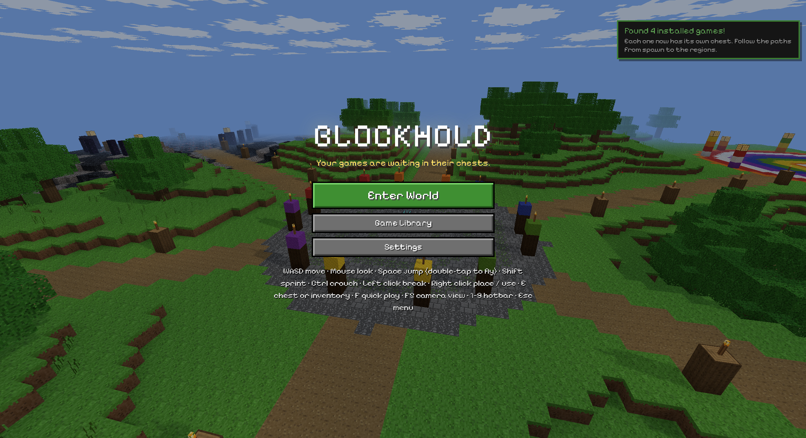
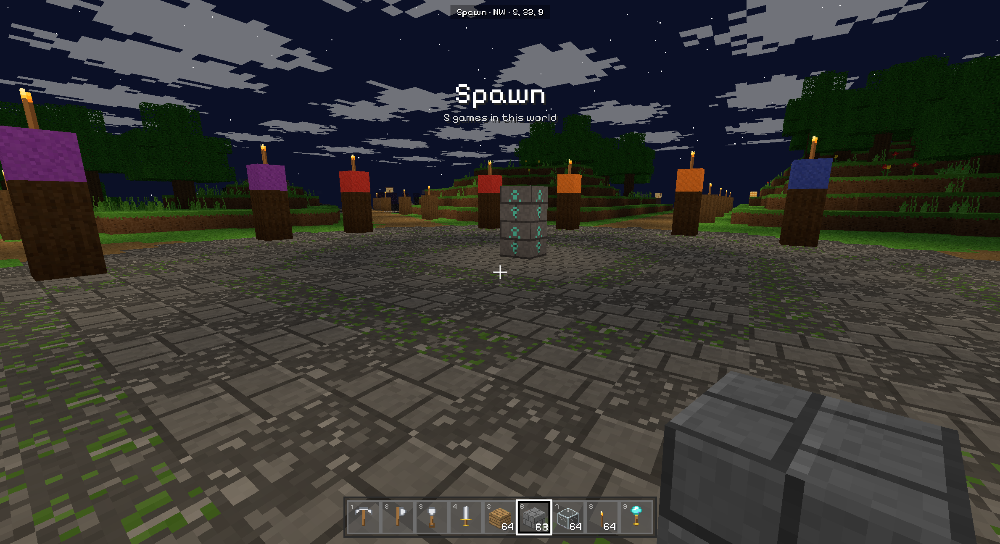
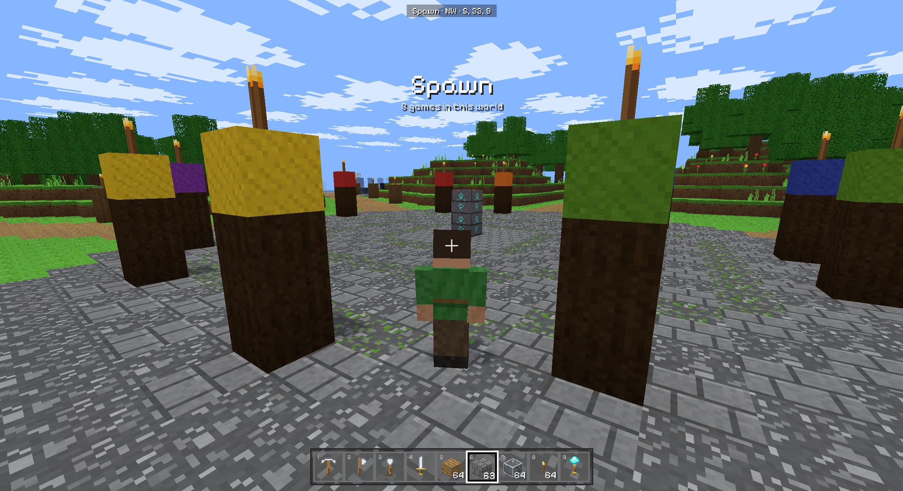

<div align="center">

# Blockhold Launcher

### Your game library, but it's a world you can walk around in.

Spawn in first person, follow the paths to six themed regions, and find every game on your PC waiting in its own chest.<br>
Open the chest, hit **Play**, and the real game launches.

[](https://github.com/ak6580123/Blockhold-Launcher/releases/latest)




</div>

---

## Features

| | |
|---|---|
| **A real world** | Endless procedural terrain with forests, hills, water, villages and day/night. Six regions surround spawn: **Survival, Adventure, RPG, FPS, Indie, Sandbox**. |
| **Games live in chests** | Every game gets a physical chest in its region, with cover art floating above it. Open it to play, edit, or move it anywhere you like. |
| **Finds your games** | Auto-discovers **Steam, Epic, GOG Galaxy, Xbox / Microsoft Store** and plain folders like `C:\Games`. Anything else can be added by hand. |
| **Actually launches them** | Direct exe, store URIs or packaged apps. It detects when a game is running and tracks playtime. |
| **Elytra & fireworks** | Strap on wings, jump off a cliff and glide. Fire a rocket mid-flight for a burst of speed, or set off a firework show from the ground. |
| **Build stuff** | Break and place blocks with a pickaxe, axe, shovel and sword. There's a full inventory, and your edits are saved. |
| **Fast travel** | Waystones link spawn and every plaza. The **Game Seeker** wand opens chests from 48 blocks away and teleports you to any game. |
| **Your own skin** | Load a skin file or fetch one by username, then press **F5** for third person. |
| **All procedural** | Every texture, model, icon and sound is generated at runtime. No third-party game assets ship with it. |

<table>
<tr>
<td></td>
<td></td>
</tr>
<tr>
<td align="center"><sub>Torchlit spawn under the stars</sub></td>
<td align="center"><sub>Third-person view (F5) with a custom skin</sub></td>
</tr>
</table>

## Install

Grab the latest build from **[Releases](https://github.com/ak6580123/Blockhold-Launcher/releases/latest)**:

- **`Blockhold Launcher Setup x.y.z.exe`**: the installer. It adds Start-menu and desktop shortcuts, lets you pick a folder, and includes an uninstaller.
- **`BlockholdLauncher-x.y.z-portable.exe`**: a single file that runs without installing.

> [!NOTE]
> The builds aren't code-signed, so Windows SmartScreen may warn you the first time. Click **More info → Run anyway**.

On first launch it scans for installed games and gives each one a chest. Follow the paths out of spawn to find them.

## Controls

| Key | Action |
|---|---|
| **WASD** / mouse | Move / look |
| **Space** | Jump · double-tap to fly · **tap while falling with an Elytra to glide** |
| **Shift** / **Ctrl** | Sprint / crouch (crouching won't walk off ledges) |
| **Left click** (hold) | Break blocks (the right tool is much faster) |
| **Right click** | Place · open chest · use waystone · Game Seeker · **firework boost** · wear Elytra |
| **E** | Open the chest you're looking at, otherwise the inventory |
| **F** | Quick-play the chest you're looking at / waystone fast travel |
| **F5** | First person → third person behind → third person front |
| **1–9**, wheel | Hotbar |
| **Esc** | Pause menu: Game Library, Settings, Return to Spawn, Quit |
| **F3** | Debug overlay |

Movement and E / F / F3 can be rebound in **Settings**.

### Flying with the Elytra

1. Open the inventory (**E**). Take an **Elytra** and some **Firework Rockets** from the item palette (new worlds start with both).
2. Wear the Elytra: right-click with it in your hand, or drop it in the **Back** slot.
3. Jump off something high and press **Space** while falling to spread your wings.
4. **Look down** to dive and gain speed, **look up** to trade that speed for height.
5. **Right-click a firework** mid-flight to rocket forward. Tap **Space** again to fold your wings.

## Build from source

You need **[Node.js](https://nodejs.org) 22+** on Windows.

```powershell
git clone https://github.com/ak6580123/Blockhold-Launcher.git
cd Blockhold-Launcher
npm install
```

Then use the build helper. Run it with no arguments for a menu:

```powershell
.\release\build.ps1            # interactive menu
.\release\build.ps1 run        # build + launch the app
.\release\build.ps1 check      # typecheck + unit tests
.\release\build.ps1 smoke      # drives the real app end-to-end, screenshots to smoke-out/
.\release\build.ps1 exe        # installer + portable .exe in release/
.\release\build.ps1 release    # checks, then both .exes
```

> [!TIP]
> If PowerShell blocks scripts, run `powershell -ExecutionPolicy Bypass -File .\release\build.ps1`.

<details>
<summary>Prefer plain npm scripts?</summary>

```bash
npm start            # build + launch
npm test             # unit tests
npm run typecheck
npm run smoke        # end-to-end smoke test
npm run dist         # installer + portable .exe
npm run dist:dir     # unpacked app in release/win-unpacked
```
</details>

Your library, settings and world live in `%APPDATA%/blockhold-launcher/` (`library.json`, `settings.json`, `world.json`). The installed, portable and dev builds all share them. Writes are atomic, and a corrupt file is backed up instead of being overwritten.

## How games & chests work

- **Discovery** (`src/main/discovery/`)
  - **Steam**: registry → `libraryfolders.vdf` → `appmanifest_*.acf`, with cover art from the local library cache.
  - **Epic**: `ProgramData/Epic/.../Manifests/*.item`.
  - **GOG Galaxy**: registry.
  - **Xbox / Microsoft Store**: `X:\XboxGames\*\Content\MicrosoftGame.config` plus `Get-AppxPackage` to resolve the AUMID.
  - **Folders**: `C:\Games`, `D:\Games`, … plus any folders you add in Settings. Each sub-folder counts as one game, and the most likely executable is picked heuristically.
- On first run, everything found is imported. Later startups only *tell* you about new games, which you can import from **Game Library → Scan for games**.
- **Manual import**: Game Library → *Add a game manually* accepts any `.exe / .lnk / .url / .bat`.
- **Regions** are guessed from the title and can be changed in the chest's **Edit** screen. Edit also covers title, description, chest style, executable, arguments, working directory, store URI, multiple named launch configurations and cover art.
- **Move chest**: pick it up and right-click to place it anywhere. **Remove** deletes the chest only, never the game.
- **Launching** (`src/main/launcher.ts`) uses a direct `spawn`, a whitelisted store URI (`steam://`, `com.epicgames.launcher://`, …), a shell open for shortcuts, or `shell:AppsFolder\<AUMID>`. **Running detection** combines child-process liveness with a process-list poll, so it also catches games started through Steam or Epic.

## Architecture

```
src/shared/        types + IPC contract + region heuristics (used by both sides)
src/main/          Electron main process: the only code touching disk, registry or processes
  main.ts          window, app:// protocol, lifecycle, save-on-close
  ipc.ts           every handler checks the sender origin and validates its payload
  validate.ts      path / URI-scheme / settings / save validation
  library.ts       game metadata         launcher.ts  launching + running/playtime
  covers.ts        cover art / exe icons → data URLs (lazy, cached)
  discovery/       steam, epic, gog, xbox, folders
  preload.ts       contextBridge: exposes window.launcher (no raw ipcRenderer, no Node)
src/renderer/      Three.js game (sandboxed renderer, strict CSP)
  engine/          blocks, procedural textures, noise, terrain, structures, chunks,
                   mesher (face culling, AO, baked torch light), streaming, sky, particles, fireworks
  player/          input, AABB physics, raycast, controller + elytra flight, hand, third-person model
  interaction/     targeting, timed breaking with crack overlay, placing
  inventory/       items + pixel-art icons, inventory + equipment
  chests/          chest models/animation, labels, covers, layout
  audio/           WebAudio-synthesised SFX + ambience
  systems/         settings manager, save system
  ui/              HUD, inventory, chest, library, settings, menus
  game.ts          orchestrator + UI state machine
release/build.ps1  build helper
```

<details>
<summary>Security</summary>

- The renderer runs with `contextIsolation`, `sandbox` and no `nodeIntegration`, under a CSP of `default-src 'self'`.
- Navigation and `window.open` are blocked.
- The renderer can only *ask* main to launch a game **by id**. Main resolves the id against its own library.
- Executable paths must exist and have an allowed extension. URIs must use a whitelisted store scheme.
- Processes are spawned without a shell (except `.bat` / `.cmd` via `cmd /c`).
</details>

<details>
<summary>Performance</summary>

- 16×16×128 chunks, each meshed into one merged geometry per material, with hidden faces culled and frustum culling per chunk.
- One 256×256 texture atlas.
- Generation and meshing run under a per-frame time budget, and edited chunks near you are remeshed first.
- Render distance is configurable (2–12 chunks), and far chunks are unloaded.
- Block particles and firework sparks are each a single instanced mesh. Covers load lazily as you approach.
</details>

## Known limitations

- Running detection matches by exe name, so an unrelated process with the same exe name can give a false positive. That's rare for games.
- Store games launched through their client are tracked once their exe appears, if its name could be determined. Otherwise the "running" state clears after about 45 s.
- The builds aren't code-signed (see the note under [Install](#install)). Signing needs a certificate configured under `build.win` in `package.json`.

<div align="center">
<sub>Built with Electron, Three.js and TypeScript. Every block, sound and pixel is generated at runtime.</sub>
</div>
