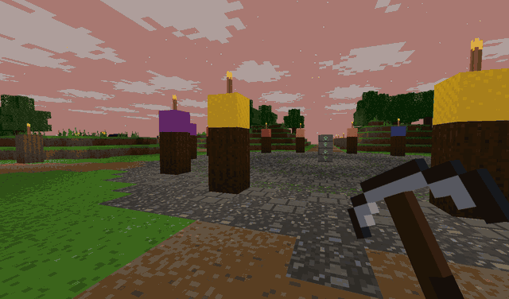
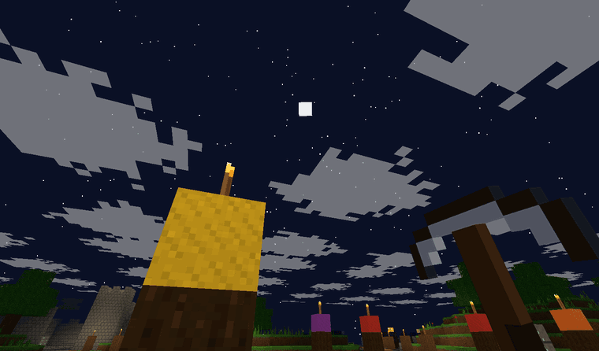

# Blockhold Launcher

A game launcher for Windows where your library is a voxel world. You walk around in first person and every game you have installed sits in a chest somewhere. Open the chest, hit Play, and the game starts.

Is this faster than clicking an icon? No. Is it better? Also probably no. But it's more fun.

[](https://github.com/ak6580123/Blockhold-Launcher/releases/latest)



## What it does

- Finds your installed games from Steam, Epic, GOG Galaxy, Xbox / Microsoft Store, and folders like `C:\Games`. You can also add any exe or shortcut yourself.
- Puts each game in a chest in one of six regions around spawn (Survival, Adventure, RPG, FPS, Indie, Sandbox). It guesses the region from the title, and you can change it.
- Launches the game, notices when it's running (even if it went through Steam or Epic), and tracks playtime.
- You can break and place blocks, move chests around, fast travel with waystones, and use your own skin.
- There's an elytra and fireworks if you want to fly around. This has nothing to do with launching games. It's there because it's fun.

All the textures, models and sounds are generated in code, so there are no assets from other games in here. The bird noises are just math.

There are shooting stars at night. These also have nothing to do with launching games.



## Download

Get it from the [releases page](https://github.com/ak6580123/Blockhold-Launcher/releases/latest). There's an installer and a portable exe. They do the same thing.

The builds aren't signed, so Windows SmartScreen will probably complain the first time. Code signing certificates cost money, and that money went to games instead. Click "More info" and then "Run anyway".

## Controls

| Key | Action |
|---|---|
| WASD, mouse | Move, look |
| Space | Jump. Double-tap to fly |
| Shift / Ctrl | Sprint / crouch |
| Left click | Break blocks |
| Right click | Place blocks, open chests, use items |
| E | Open the chest you're looking at, or your inventory |
| F | Quick-play the chest you're looking at |
| F5 | Switch camera view |
| 1-9, scroll | Hotbar |
| Esc | Menu (library, settings, quit) |
| F3 | Debug info |

Most of these can be rebound in Settings.

**Flying:** put the elytra on (right-click it, or drag it into the Back slot in your inventory), jump off something high, and press Space while you're falling. Look down to speed up and up to climb. There's no fall damage, so crashing into a mountain only hurts your pride. Right-click a firework while gliding for a boost. New worlds give you both items. In an older world, take them from the item palette in the inventory.

## Building from source

You need Windows and Node.js 22 or newer.

```powershell
git clone https://github.com/ak6580123/Blockhold-Launcher.git
cd Blockhold-Launcher
npm install
.\release\build.ps1
```

`build.ps1` with no arguments shows a menu. You can also run it with a command:

- `run`: build and start it
- `check`: typecheck and tests
- `exe`: build the installer and portable exe into `release/`
- `clean`: delete build output

If PowerShell won't run the script, use `powershell -ExecutionPolicy Bypass -File .\release\build.ps1`. The plain npm scripts (`npm start`, `npm test`, `npm run dist`) work too.

Your library, settings and world are saved in `%APPDATA%\blockhold-launcher\`.

## Project layout

```
src/main/        Electron main process: game discovery, launching, saving files
src/renderer/    the game itself (Three.js)
src/shared/      types shared by both
tests/           unit tests
scripts/         smoke test that drives the real app
```

The renderer is sandboxed and can't touch the disk or start processes. It asks the main process to launch a game by its id, and the main process checks everything before doing it.

## Known issues

- Running detection goes by exe name, so a different program with the same exe name can make a game look like it's running.
- If a game is launched through a store and its exe name can't be worked out, it only shows as running for about 45 seconds.
- The builds aren't code-signed (hence the SmartScreen warning).
- You will open the launcher to play a game and end up building a house instead. This is not a bug.
